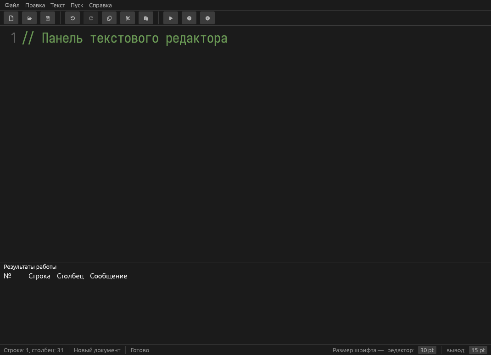
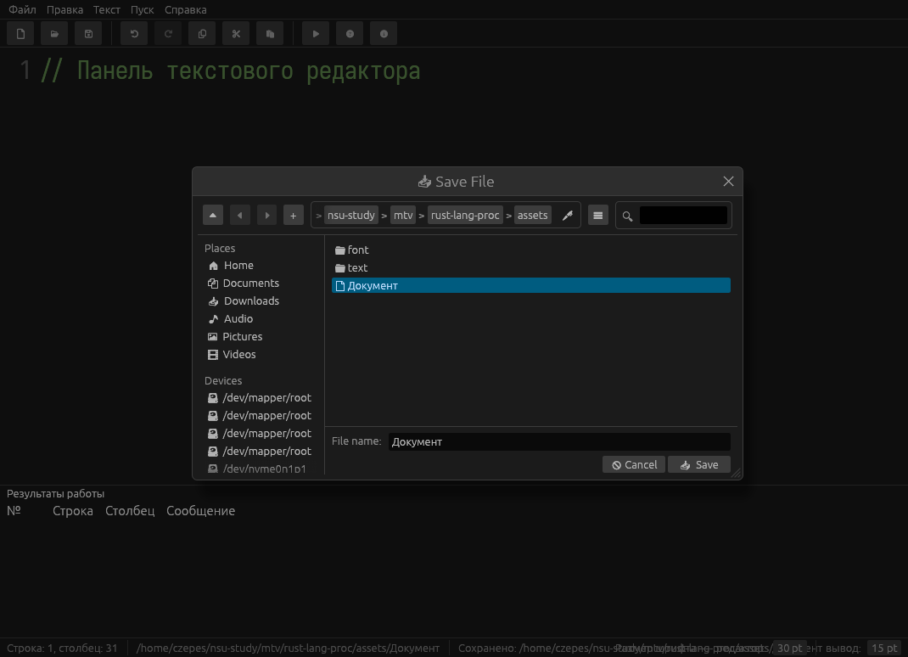
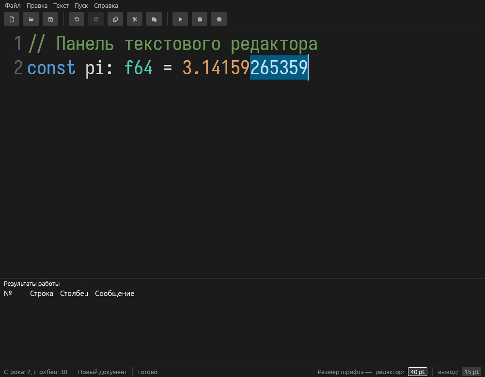
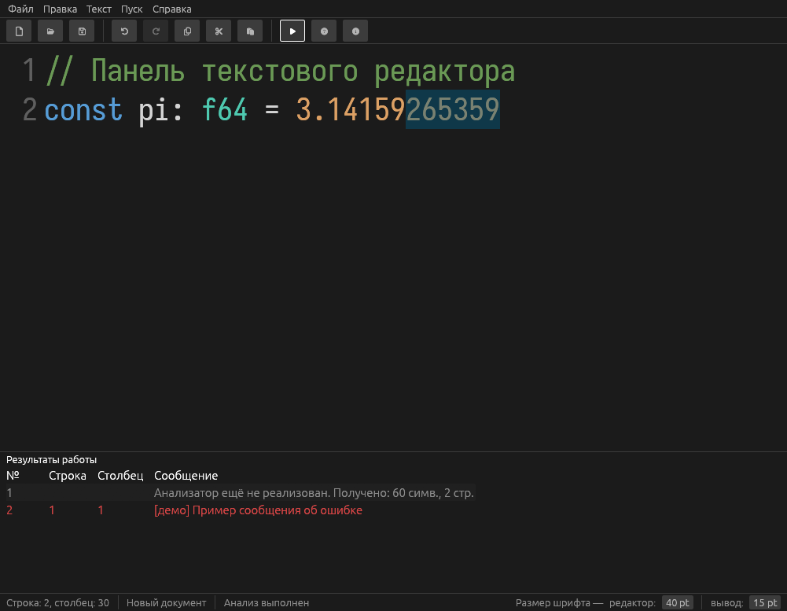
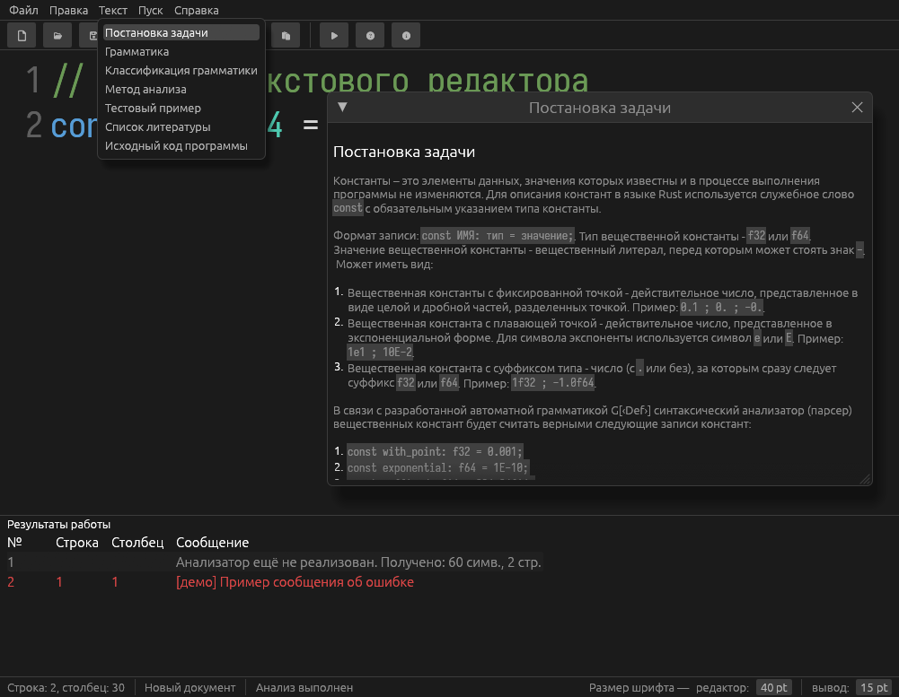
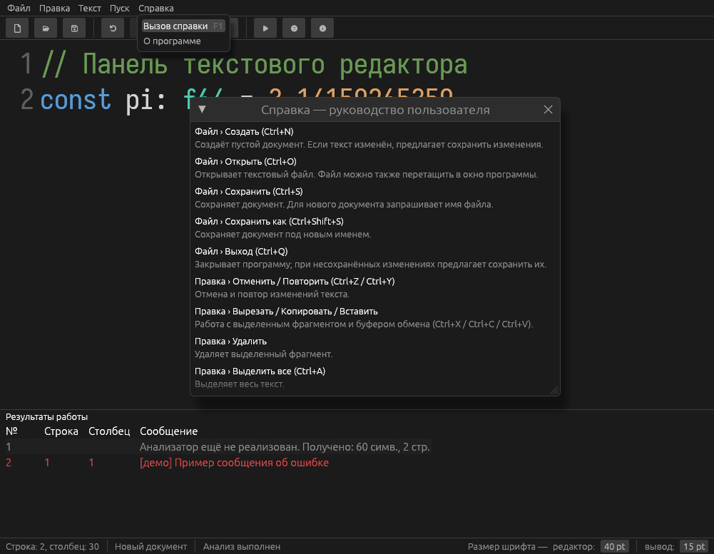

# Rust Language Processor

Руководство пользователя графического текстового редактора — оболочки для будущего языкового процессора.

## Запуск

Требуется Rust 1.95+ и Cargo. В каталоге проекта выполните:

```bash
cargo run --release
```

Для сборки исполняемого файла:

```bash
cargo build --release
```

После сборки запустите `target/release/rust-lang-proc`

## Главное окно

Окно состоит из главного меню, панели инструментов, редактора текста и области результатов. В редакторе показаны номера строк, доступна подсветка `const`, типов `f32`/`f64`, чисел и однострочных комментариев `//`. Для редактора и области результатов предусмотрены отдельные полосы прокрутки.

Нижняя область «Результаты работы» отображает сообщения в виде таблицы с номером, строкой, столбцом и текстом сообщения. Перетаскивайте границу этой области, чтобы изменить её высоту относительно редактора. В строке состояния показаны позиция курсора, имя/путь документа, состояние операции и поля изменения размера шрифта редактора и результатов.



## Работа с документами

Команды доступны в меню **Файл** и на панели инструментов:

- **Создать** (`Ctrl+N`) — создаёт пустой документ. Если текущий документ изменён, перед переключением появится запрос на сохранение.
- **Открыть** (`Ctrl+O`) — открывает текстовый файл. Также файл можно перетащить в окно приложения.
- **Сохранить** (`Ctrl+S`) — сохраняет изменения в текущий файл. Для нового документа откроется диалог выбора имени и расположения.
- **Сохранить как** (`Ctrl+Shift+S`) — сохраняет документ в файл с новым именем или в другом расположении.
- **Выход** (`Ctrl+Q`) — закрывает программу. Если есть несохранённые изменения, появится запрос.

В запросе сохранения выберите **Да**, чтобы сохранить изменения перед действием, **Нет** — продолжить без сохранения, или **Отмена** — остаться в текущем документе. Звёздочка `*` после имени документа в заголовке окна означает, что имеются несохранённые изменения. Закрытие окна кнопкой закрытия также учитывает несохранённые изменения.



## Редактирование текста

Команды меню **Правка** работают с текстом в редакторе:

| Команда | Действие | Клавиши |
|---|---|---|
| Отменить | Отменить последнее изменение | `Ctrl+Z` |
| Повторить | Повторить отменённое изменение | `Ctrl+Y` |
| Вырезать | Удалить выделенный фрагмент и поместить его в буфер обмена | `Ctrl+X` |
| Копировать | Скопировать выделенный фрагмент в буфер обмена | `Ctrl+C` |
| Вставить | Вставить текст из буфера обмена | `Ctrl+V` |
| Удалить | Удалить выделенный фрагмент | `Del` |
| Выделить все | Выделить всё содержимое редактора | `Ctrl+A` |

Размер текста редактора можно менять полем **редактор** в строке состояния или клавишами `Ctrl++` / `Ctrl+-`; `Ctrl+0` возвращает размер по умолчанию. Размер шрифта области результатов задаётся отдельным полем **вывод**. Оба размера можно настроить в пределах, доступных в интерфейсе.



Нажмите **Пуск** на панели инструментов или в главном меню, чтобы запустить анализ текущего текста. Также доступна клавиша `F5`. Сообщения появляются в нижней таблице. Если сообщение связано с позицией в тексте, щелчок по нему перемещает курсор к указанной строке и столбцу и выделяет соответствующий фрагмент.

**В текущей версии полноценный языковой анализатор ещё не реализован. **При запуске отображается информационное сообщение о количестве символов и строк; для демонстрации навигации может выводиться пример сообщения об ошибке для первого слова непустой строки. Это демонстрационные данные, а не результат проверки синтаксиса программы.



## Меню «Текст»

Пункты меню открывают отдельные окна с информацией:

- **Постановка задачи** — отображает формулировку задания.
- **Грамматика**, **Классификация грамматики**, **Метод анализа**, **Тестовый пример**, **Список литературы**, **Исходный код программы** — в текущей версии показывают сообщение «Этот раздел будет реализован позже».



## Справка и сведения о программе

Откройте **Справка → Вызов справки** или нажмите `F1`, чтобы увидеть краткие описания команд и возможностей. Пункт **Справка → О программе** (также кнопка на панели инструментов) показывает название и версию приложения.


